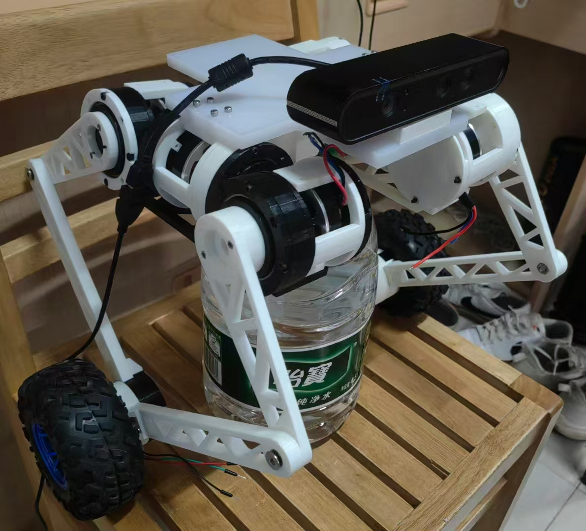
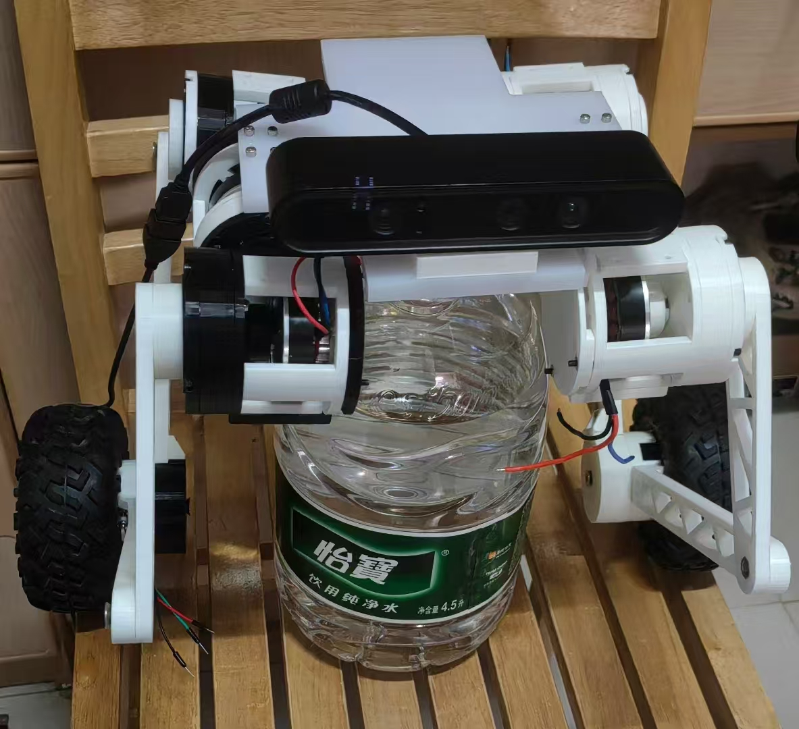
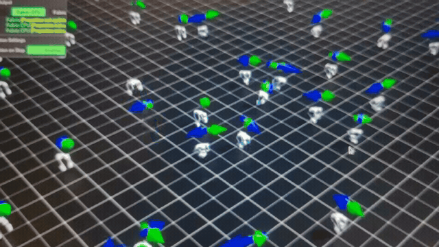
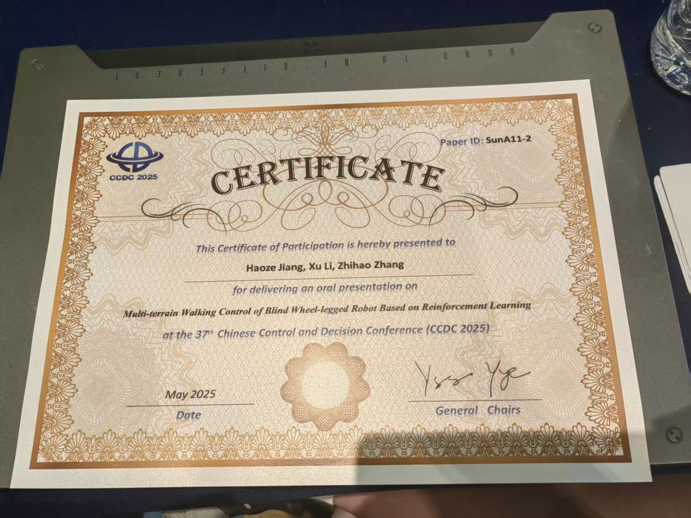

# Luntui Robot · 轮腿机器人

面向轮腿机器人研究与展示的机械设计、仿真模型及实物资料仓库。



## 项目概览

本项目整理了轮腿机器人的 SolidWorks 零件与装配体、USD / FBX 模型，以及实物照片和演示视频，可用于了解结构设计和后续仿真开发。

- **机械设计**：包含腿部、轮组、连接件、电机相关结构及箱体装配资料。
- **模型资源**：提供 SolidWorks 原始文件、部分 3MF、DWG / DXF 文件，以及 USD / FBX 模型。
- **实物展示**：展示机器人装配形态，并附项目视频。

当前仓库以模型和展示资料为主，未包含控制程序、强化学习训练代码或可直接复现实验的运行环境；模型的动力学参数和运行效果需要在使用前验证。

## 实物与视频

| 正面视角 | 侧面视角 |
| --- | --- |
|  |  |



完整视频的自动循环动图（无声）。[查看 / 下载原视频](1.mp4)

## 交流展示

随项目提供的 CCDC 2025 参会证书记录了以下口头报告：

> Multi-terrain Walking Control of Blind Wheel-legged Robot Based on Reinforcement Learning

证书署名：Haoze Jiang、Xu Li、Zhihao Zhang。会议：第 37 届中国控制与决策会议（CCDC 2025），2025 年 5 月。



## 目录结构

```text
luntui-robot/
├── README.md
├── assets/demo.gif       # 自动循环演示动图
├── 1.mp4                 # 项目视频
├── 2.jpg                 # 参会证书
├── 3.jpg / 4.jpg         # 实物照片
├── 仿真模型/luntui/       # USD、FBX 与相关 SolidWorks 文件
└── 机械模型/             # 零件、装配体与部分制造交换文件
```

## 使用模型

1. 下载仓库并保留原始目录结构，以便装配体查找关联零件。
2. 使用兼容版本的 SolidWorks 打开 `.SLDASM` / `.SLDPRT` 文件；若提示缺少引用，请在对应模型目录中重新定位零件。
3. 使用支持 USD 或 FBX 的工具导入仿真模型；运行前检查单位、坐标轴、关节约束、质量与碰撞几何。
4. 3MF 文件可用于查看网格或导入切片工具；加工前需自行核对尺寸、公差与材料。

仓库保留了多个模型版本，文件名不代表已经验证的最终版本。软件版本、装配完整性及仿真兼容性尚未在本仓库中验证。

## 使用说明

本仓库用于项目展示与技术交流。目前未指定开源许可证；公开展示不等同于授予任意复制、修改或商业使用权限，使用前请与权利人确认。
